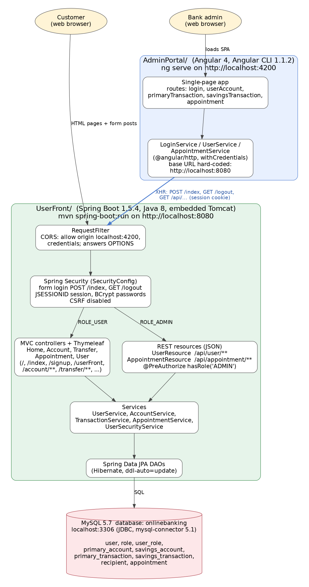

# Online Banking with Java, Spring Boot, Angular 2

Developed an Banking website which lets you deposit or withdraw money, schedule an appointment with a banker, view bank statements, transfer money between primary or savings account or with other customer.

The repository holds two apps that share one Spring Boot backend and one MySQL database:

- User Frontend (`UserFront/`): the Spring Boot server. It renders the customer pages and also serves the JSON API used by the Admin Portal.
- Admin Portal (`AdminPortal/`): an Angular single-page app with no server of its own; it calls the User Frontend API on port 8080.

## Architecture



Details are in [docs/ARCHITECTURE.md](docs/ARCHITECTURE.md). The diagram's editable source is [docs/diagrams/architecture.dot](docs/diagrams/architecture.dot).

## User Frontend 

User-Front is a user-facing system and it includes modules such as User Signup/Login, Account, Transfer, Appointment, Transaction and User Profile.

## Admin Portal

It is mainly used by Admin and it involves User Account and Appointment modules. Admin can enable/disable Users, view statements of every Users, confirm an appointment.

## Technologies Used

**Front-end:** Html5/CSS3, JavaScript, TypeScript, JQuery, Bootstrap, Angular 4 (Angular CLI 1.1.2) and some JS plugins, JSON, Thymeleaf

**Back-end:** Java 8, Spring Boot 1.5, Spring Data JPA, Spring Security, Hibernate, MySQL, Maven, SLF4J/Logback

## Getting Started

### Prerequisites

- JDK 8 (Spring Boot 1.5.4 targets Java 8) and Maven 3
- MySQL 5.7 on `localhost:3306`
- Node.js 12 for the Admin Portal (Angular CLI 1.1.2 predates current Node releases)

### 1. Database

The backend connects to database `onlinebanking` as `root` / `avengers1993` (see `UserFront/src/main/resources/application.properties`). With Docker:

```bash
docker run -d --name onlinebanking-mysql -p 3306:3306 \
  -e MYSQL_ROOT_PASSWORD=avengers1993 -e MYSQL_DATABASE=onlinebanking mysql:5.7
```

To use other credentials, override them at startup, e.g. `SPRING_DATASOURCE_PASSWORD=... mvn spring-boot:run`.

### 2. User Frontend (backend, port 8080)

```bash
cd UserFront
mvn test               # context-load test; needs the database from step 1
mvn spring-boot:run    # http://localhost:8080
```

Hibernate creates the tables on first start. The app does not seed roles, so insert them once after the first start (until `ROLE_USER` exists, sign-up shows an error page: "Target object must not be null"):

```sql
INSERT INTO onlinebanking.role (role_id, name) VALUES (1, 'ROLE_USER'), (2, 'ROLE_ADMIN');
```

Sign up at http://localhost:8080/signup. To make a user an admin for the Admin Portal:

```sql
INSERT INTO onlinebanking.user_role (user_id, role_id)
SELECT user_id, 2 FROM onlinebanking.user WHERE username = '<username>';
```

### 3. Admin Portal (Angular, port 4200)

```bash
cd AdminPortal
npm install
npx ng serve           # http://localhost:4200, log in with the admin user
```

The portal expects the backend at `http://localhost:8080`, and the backend only allows CORS requests from `http://localhost:4200`, so keep both ports as they are.
