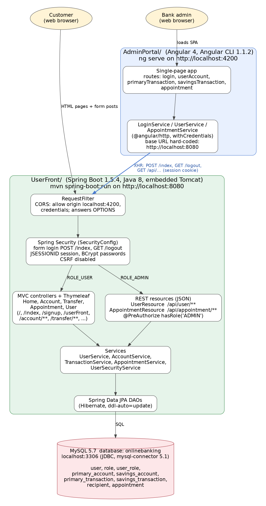

# Architecture

This repository holds two apps that share **one backend and one database**:

| App | Folder | Stack | Runs on | Who uses it |
|---|---|---|---|---|
| UserFront | `UserFront/` | Spring Boot 1.5.4, Java 8, Spring MVC + Thymeleaf, Spring Security, Spring Data JPA / Hibernate | `http://localhost:8080` | Customers (server-rendered pages) **and** the AdminPortal (JSON API) |
| AdminPortal | `AdminPortal/` | Angular 4 (Angular CLI 1.1.2, TypeScript 2.3) | `http://localhost:4200` (`ng serve`) | Bank admins |

AdminPortal has no server of its own: it is a static single-page app that calls the
UserFront backend. UserFront is the only process that talks to the database.

Editable source: [`diagrams/architecture.dot`](diagrams/architecture.dot) (Graphviz).
Re-render `architecture.png` and `architecture.svg` with `docs/diagrams/render.sh`
(needs `dot`, e.g. `sudo apt-get install graphviz`).

## UserFront (Spring Boot backend + customer UI)

- **Entry point:** `com.userFront.UserFrontApplication`.
- **Customer UI:** MVC controllers in `controller/` (`HomeController`, `AccountController`,
  `TransferController`, `AppointmentController`, `UserController`) render Thymeleaf
  templates from `src/main/resources/templates/` for sign-up, accounts, deposits/withdrawals,
  transfers, recipients, appointments and the profile page.
- **Admin API:** REST controllers in `resource/` return JSON and require `ROLE_ADMIN`
  (`@PreAuthorize("hasRole('ADMIN')")`):
  - `UserResource`: `GET /api/user/all`, `/api/user/primary/transaction?username=`,
    `/api/user/savings/transaction?username=`, `/api/user/{username}/enable`, `/api/user/{username}/disable`
  - `AppointmentResource`: `GET /api/appointment/all`, `/api/appointment/{id}/confirm`
- **Security (`config/SecurityConfig`):** form login at `POST /index`, logout at `GET /logout`,
  HTTP session (`JSESSIONID`) plus remember-me, BCrypt password hashes, CSRF disabled.
  Users are loaded from the database by `UserSecurityService`.
- **CORS (`config/RequestFilter`):** a servlet filter that allows origin
  `http://localhost:4200` with credentials and answers `OPTIONS` pre-flights itself.
- **Persistence:** Spring Data JPA DAOs in `dao/`, entities in `domain/`. Hibernate creates
  and updates the schema on startup (`spring.jpa.hibernate.ddl-auto = update`).

## AdminPortal (Angular admin UI)

- Routes (`src/app/app.routing.ts`): `login`, `userAccount`, `primaryTransaction/:username`,
  `savingsTransaction/:username`, `appointment`.
- `LoginService`, `UserService` and `AppointmentService` call the backend with
  `@angular/http` and `withCredentials: true`, so the browser sends UserFront's session
  cookie with every request. The backend URL `http://localhost:8080` is hard-coded in
  those services (not in `environments/`).
- Login posts the admin's username and password to UserFront's `POST /index` form login.
  A successful login only sets `localStorage.PortalAdminHasLoggedIn`; authorization is
  enforced by the backend on each `/api/**` call.

## Database

- **MySQL**, database `onlinebanking` on `localhost:3306`, configured in
  `UserFront/src/main/resources/application.properties` (user `root`, password
  `avengers1993`, `MySQL5Dialect`, MySQL Connector/J 5.1 from the Spring Boot 1.5 BOM).
  Tested with MySQL 5.7.
- Tables generated from the entities: `user`, `role`, `user_role`, `primary_account`,
  `savings_account`, `primary_transaction`, `savings_transaction`, `recipient`, `appointment`.
- Roles are **not** seeded by the app. Sign-up looks up `ROLE_USER` by name, and the admin
  API needs `ROLE_ADMIN`, so both rows must be inserted by hand (see the README).

## Request flows

1. **Customer:** browser → UserFront `:8080` → Spring Security form login → MVC controller →
   service → DAO → MySQL → Thymeleaf HTML.
2. **Admin:** browser loads the SPA from `:4200` → SPA posts credentials to `:8080/index`
   (cross-origin, allowed by `RequestFilter`) → later XHRs to `:8080/api/**` carry the
   session cookie → `@PreAuthorize` checks `ROLE_ADMIN` → service → DAO → MySQL → JSON.

## Known limitations (as of this writing)

- `GET /api/user/all` serializes the full `User` entity, including the BCrypt password hash.
- The CORS origin, backend URL and database credentials are hard-coded for localhost.
- AdminPortal's Karma unit tests (`ng test`) are the Angular CLI scaffolds and do not run
  with the current toolchain; `ng build` and `ng serve` work.
